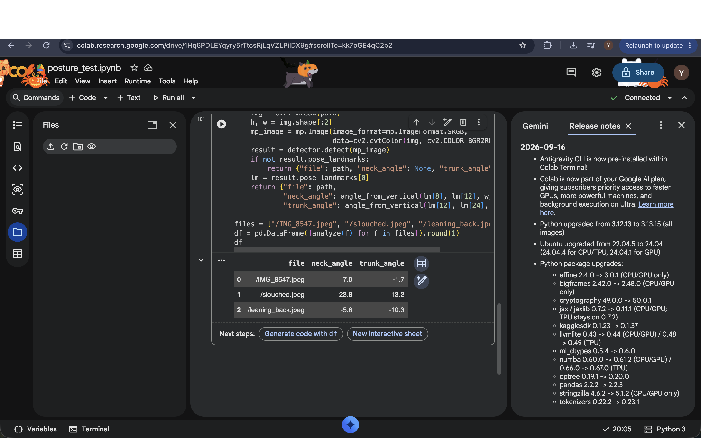

# posture-camera-angle-study
# Posture Assessment from Phone Photos: Effect of Camera Angle

A small pilot study of how camera angle (front, 45°, side) affects posture
classification and joint-angle estimation using MediaPipe Pose.

**Status:** in progress (target completion: mid-November 2026)

## Research question
How does camera angle affect the accuracy of posture assessment from
MediaPipe Pose landmarks?

## Plan
- Photograph volunteers (with consent) in 3 postures × 3 camera angles
- Extract landmarks with MediaPipe, compute neck and trunk angles
- Evaluate classification accuracy per angle (leave-one-person-out)
- Analyze failure cases
- ## First pipeline test (single subject)

Neck and trunk angles computed from MediaPipe landmarks for three postures.

## Tools
Python, MediaPipe Pose, OpenCV, pandas, NumPy, scikit-learn, Google Colab
